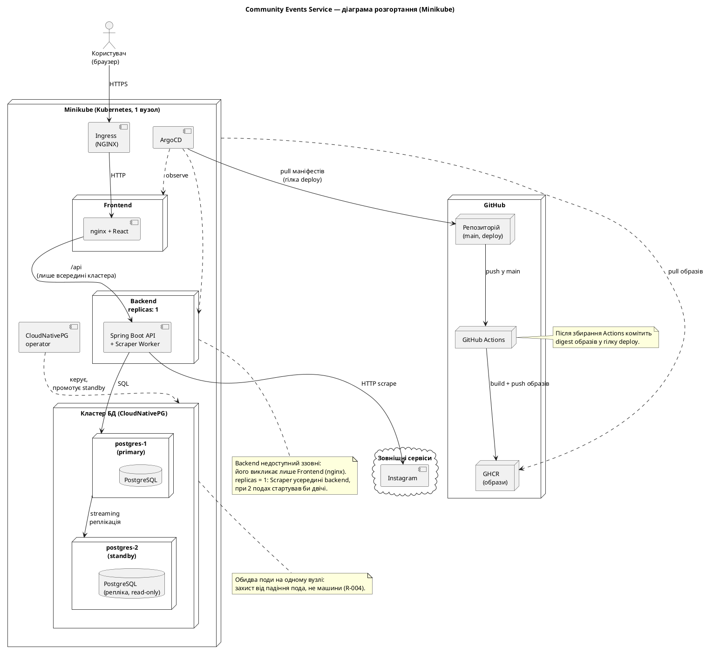

# Діаграма розгортання

Файл для здачі Lab 3: **[deployment.puml](deployment.puml)**.

Рендер: розширення PlantUML в IDE або [plantuml.com](https://www.plantuml.com/plantuml).

Рішення, що за нею стоять: [ADR-004](../decisions/ADR-004-deployment-and-gitops.md).

## Вузли та артефакти

Діаграма навмисно без деталей конфігурації: Service-и (`frontend-svc`, `backend-svc`, `postgres-rw`), Secret-и, ConfigMap, PVC і namespace-и показані лише тут. Сервіси додатку живуть у namespace `default` (одне середовище, без dev/stage), утиліти (ArgoCD, CloudNativePG, ingress-nginx) — у власних стандартних namespace.

| Вузол | Артефакт | Що робить | Вимоги |
|-------|----------|-----------|--------|
| Ingress | NGINX ingress addon Minikube (+ Service `frontend-svc`, `backend-svc`) | Єдина точка входу ззовні, веде лише на frontend; TLS | NFR-010 |
| Deployment `frontend` | образ `frontend` (nginx + React-білд) | Віддає статичний SPA і проксує `/api` на backend усередині кластера (backend ззовні недоступний) | ADR-002 |
| Deployment `backend` (replicas 1) | образ `backend` (Spring Boot) | Доступний лише з frontend (Service типу ClusterIP). API, Auth, Organizations, Events & Moderation, Bulletin Board, Calendar Export + Scraper Worker (`@Scheduled`) | ADR-001, ADR-003, NFR-003 |
| ConfigMap / Secret (на діаграмі не показані) | `backend-config`, секрети | Налаштування, JWT-секрет, токени соцмереж, доступ до БД | NFR-010 |
| CNPG Cluster `postgres` | 2 поди PostgreSQL, кожен зі своїм PVC | primary + standby зі streaming-реплікацією; Service `postgres-rw` завжди веде на primary | NFR-004, NFR-005, NFR-006 |
| CloudNativePG operator | Deployment у `cnpg-system` | Створює поди БД, стежить за ними, промотує standby при падінні primary | NFR-004 |
| ArgoCD | `argocd`, `targetRevision: deploy` | Тягне маніфести з гілки `deploy` і застосовує їх у `default` | ADR-004 |
| GitHub Actions + GHCR | pipeline, образи `frontend` і `backend` | Збирає образи, пушить у GHCR, комітить digest у гілку `deploy` | ADR-004 |

## Використання ШІ

Діаграма й опис складені в Claude Code на основі HLD, ADR-001…003, data-model і NFR; рішення (один Deployment на сервіс, CloudNativePG, GitOps з гілкою `deploy`) ухвалила команда.
