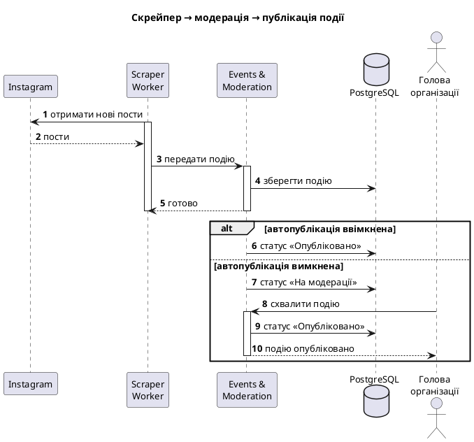

# Діаграма послідовності

Файл для здачі Lab 3: **[sequence.puml](sequence.puml)**.

Рендер: розширення PlantUML в IDE або [plantuml.com](https://www.plantuml.com/plantuml).

Сценарій: **скрейпер → модерація → публікація події**. Анонс з Instagram автоматично стає подією, а голова організації контролює, що саме публікується.

## Як читати

- Scraper Worker сам за розкладом (FR-023) забирає пости з Instagram і передає подію в Events & Moderation, який зберігає її в PostgreSQL.
- `alt` розходиться за налаштуванням організації `auto_publish` (FR-029…031): подія або одразу стає опублікованою, або отримує статус «На модерації» і невидима гостям і User (FR-030).
- У другій гілці голова схвалює подію (FR-035), і вона публікується.
- Усі повідомлення синхронні (викликач чекає відповіді). Асинхронних немає, бо брокера повідомлень у системі нема (ADR-003).
- Навмисно спрощено: Web Client і API Controllers між головою та Events не показані, так само дедуплікація, повтори та відмови джерел (NFR-005, NFR-007). Показано лише Instagram, як у `data-model.md`.

## Використання ШІ

Діаграма складена в Claude Code за FR-023…035 і `components.puml`; вибір сценарію й рівня деталізації узгоджено з командою.
